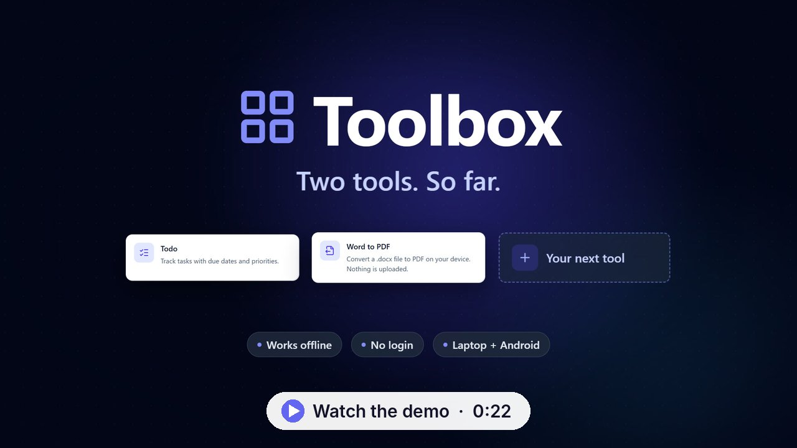

# Toolbox

A personal collection of small tools in one app. It runs in the browser on a laptop (installable as a PWA) and on an Android phone (as an APK). Everything works **offline**: there is no backend and no login, and your data stays on the device.

[](docs/media/toolbox-demo.mp4)

*A 22-second demo of the app: adding a todo and converting a Word file to PDF. Click the image to watch it.*

It contains these tools so far:

- **Todo**: a task list with due dates, priorities, filters and sorting.
- **Word to PDF**: pick a `.docx`, preview it, and get a PDF. Everything happens on the device; nothing is uploaded. [Details below](#word-to-pdf).
- **Notifier**: type a reminder, pick a date and time, and get a notification with exactly that text. [Details below](#notifier).
- **Daily Read**: one lesson from your own books every day, as a notification you cannot swipe away, with a deep read and spaced quick recalls. [Details below](#daily-read).

The app is built so that more, unrelated tools can be dropped in without touching the rest. See [docs/ADDING_A_TOOL.md](docs/ADDING_A_TOOL.md).

**Stack:** React 19 · TypeScript (strict) · Vite · React Router · Tailwind CSS · Dexie (IndexedDB) · vite-plugin-pwa · Capacitor (Android) · Vitest. Word to PDF adds docx-preview, html2canvas-pro and jsPDF (all loaded only when that tool is used).

## Run it on your laptop

You need [Node.js](https://nodejs.org) 22 or newer.

```bash
npm install
npm run dev
```

Open <http://localhost:5173>. Edits reload instantly.

| Command | What it does |
| --- | --- |
| `npm run dev` | Dev server with hot reload |
| `npm run build` | Type-check (`tsc -b`) and build the production PWA into `dist/` |
| `npm run preview` | Serve `dist/` locally, to try the production build and the service worker |
| `npm test` | Run all tests once (`npm run test:watch` to keep them running) |
| `npm run typecheck` | TypeScript only |
| `npm run icons` | Re-render every app icon (PWA, favicon, Android) from `scripts/generate-icons.mjs` |
| `npm run sample:docx` | Re-create `docs/samples/sample.docx`, a small Word file for trying Word to PDF |
| `npm run android:build` | Build the Android debug APK (see below) |
| `npm run android:check` | Report whether the JDK / Android SDK needed for the APK are installed |
| `npm run android:sync` | Rebuild the web bundle and copy it into the Android project |
| `npm run android:open` | Open the Android project in Android Studio |

## Install it as an app on your laptop (PWA)

1. `npm run build && npm run preview`, then open <http://localhost:4173> in Chrome or Edge.
2. Click the install icon in the address bar (or menu → *Install Toolbox*).

The service worker caches the whole app, so it keeps working with no network. To use it day to day without a dev server running, host the `dist/` folder anywhere static (GitHub Pages, Netlify, any web server). It uses hash URLs (`#/todo`) so no server rewrite rules are needed. Browsers only allow installing from `https://` or `localhost`.

## Word to PDF

Open the tool, choose a `.docx` (or drag one onto the page on a laptop), look over the preview, and press **Convert to PDF**. A sample to try is in [`docs/samples/sample.docx`](docs/samples/sample.docx): it has a heading, bold/italic/underlined text, bullet and numbered lists, a table and an image.

- **Laptop / browser:** the PDF downloads, named like the original (`Report.docx` becomes `Report.pdf`). "Download again" saves another copy.
- **Android app:** a blob download does not work inside the app's WebView, so the PDF is written to the app's cache with the Capacitor Filesystem plugin and the system **share sheet** opens (Share plugin). From there you can open it, save it to Files or Drive, or send it. "Open / Share" brings the sheet back. No storage permissions are needed.
- **Limits:** `.docx` only, up to 20 MB. The old `.doc` format and password-protected files are not supported, and the tool says so.

### How it works

1. The document is rendered to HTML in a hidden, sandboxed iframe with [docx-preview](https://github.com/VolodymyrBaydalka/docxjs). (An iframe keeps Tailwind's CSS reset from mangling the document, and, because it can't run scripts, a malicious link inside an untrusted file can't do anything.)
2. It is split into A4-sized pages (`src/tools/word-to-pdf/paginate.ts`). Word files from Google Docs, LibreOffice and most generators contain no page boundaries, so a 5-page document would otherwise arrive as one very tall page. Pages break between paragraphs (never through a line of text), a heading stays with the text after it, long tables break between rows, and headers/footers and margins repeat on every page. The preview shows the same pages the PDF gets.
3. Each page is drawn to a canvas with [html2canvas-pro](https://github.com/yorickshan/html2canvas-pro) and added to an A4 PDF with [jsPDF](https://github.com/parallax/jsPDF). Letter-size and landscape pages are scaled to fit and centred.

**Why these libraries, not `html2pdf.js`:** `html2pdf.js` is still maintained, but it is a thin wrapper around `html2canvas` 1.4.1 (last released in 2022, and unable to read modern CSS colours) and jsPDF, and it cuts the page into slices by pixel height, which ignores Word's own pages. Using the maintained `html2canvas-pro` fork and jsPDF directly gives page-aware output. jsPDF's optional imports (`canvg`, `dompurify`, the old `html2canvas`) are aliased away in `vite.config.ts` because the app never uses those features; this keeps about 370 KB out of the offline cache and the APK.

### What converts well, and what does not

Converts well: headings and paragraph styles, bold / italic / underline / colours / font sizes, bullet and numbered lists, tables (borders, shading, alignment), images, page margins, explicit page breaks, headers and footers.

**Seen in testing** (two generated documents: one with an explicit page break, one 6 pages long with no page breaks and a 44-row table; checked in a desktop browser and on an Android emulator):

- **The PDF is made of page images.** It looks like the document, but its text can't be selected, searched or copied, and files are larger than a text PDF (about 0.5 MB per page).
- **A table's header row is not repeated** when the table continues on the next page.

**Expected from how it works, but not tested** (no real-world Word or Google Docs files were available to try):

- **Fonts:** only fonts installed on the device are used, so a document in Calibri or Cambria falls back to a similar font and line breaks can shift slightly.
- **Page numbers in a header/footer** are copied as saved, so a re-flowed document can repeat the same number on each page.
- **Not rendered or only approximated:** text boxes, WordArt, SmartArt, charts, equations, and complex floating-image layouts (limits of docx-preview).
- **US Letter and landscape pages** are scaled to fit and centred on A4. This is implemented but was not run against such a file.
- A single paragraph or image taller than a whole page is cut into page-height strips (implemented, not exercised).

## Notifier

Type a message (for example *Ask teacher about AICTE points*), pick a date and a time, and press **Save reminder**. At that minute the device shows a notification whose only text is your message exactly as typed, with no separate heading. A short message is shown as the large title line; a long one (over about 40 characters) is shown as normal-size text you can expand to read in full, because Android cuts a title to one line. Tapping it opens the app on the Notifier screen. Reminders are listed under **Upcoming** and **Past**; each can be edited (the notification is re-scheduled) or deleted (it is cancelled), and **Clear past reminders** removes the old ones. **Test notification** sends one in 10 seconds.

- **Android app:** Android itself delivers the notification from an exact alarm, so it arrives with the app closed and the phone locked. Notification permission is asked for the first time you save a reminder. Reminders survive a restart of the phone (the plugin re-arms them at boot), and the app also re-schedules every upcoming reminder each time it opens.
- **Laptop (browser / installed PWA):** browsers cannot wake a closed web app, so **reminders only appear while the app is open** (a tab, or the installed app window, minimised is fine). Each time the app opens it re-arms the upcoming reminders from storage; anything that came due while it was closed is listed as **Missed**. The page says this too.

### Phone settings for reliable reminders

1. **Notifications: allowed.** Tap *Allow* when asked. If you tapped *Don't allow*: Settings > Apps > Toolbox > Notifications > on. The app shows a banner while they are off.
2. **Alarms & reminders: allowed.** On Android 13 and newer this is granted automatically. On Android 12, if the app shows "Reminders may arrive a few minutes late", tap *Open setting* and turn it on.
3. **Battery: Unrestricted.** Settings > Apps > Toolbox > Battery > *Unrestricted*. On Xiaomi, Oppo, Vivo, Realme, OnePlus, Samsung and similar phones also turn on **Autostart** / allow background activity for Toolbox, and lock it in the recent-apps screen if your phone offers that. These phones can otherwise stop the app's alarms.
4. **Do not "Force stop" the app.** Swiping it away from recent apps is fine; *Force stop* in Settings cancels its alarms until you open it again (opening it re-schedules them).
5. **Do Not Disturb** hides notifications unless Toolbox is allowed to break through.

### Test it on your phone with the app fully closed

1. Install the new APK and open **Toolbox > Notifier**.
2. Type a message, set the time to 2 or 3 minutes from now, and press **Save reminder**. Tap **Allow** on the permission question.
3. Close the app completely: open the recent-apps screen and swipe Toolbox away. Lock the phone.
4. Wait. At that minute the notification appears on the lock screen with your exact text. Tap it: the app opens on Notifier, and the reminder is under **Past** marked **Sent**.

For a quicker check, press **Test notification**, then close the app and lock the phone: it arrives 10 seconds later.

### How it works

`src/shared/notifications` is a reusable notification service (see [docs/ADDING_A_TOOL.md](docs/ADDING_A_TOOL.md)). On Android it uses `@capacitor/local-notifications` with exact, allow-while-idle alarms on a high-importance channel; in a browser it uses the Web Notifications API with in-page timers. The platform is picked at runtime. Reminders are stored through `src/shared/storage` like the todo list. The tool's manifest has an `onAppStart` hook, so the reminders are re-armed every time the app opens, whatever screen it opens on.

## Daily Read

Every day, at a time you choose, you get a notification with one lesson from a book you added. Tap it (or **Read now**) and the lesson opens: the 30-second version, the book's **exact original text** (serif font, quote border), a step-by-step explanation, real-world implications, extra thoughts and a small thing to try today. It is amber-coloured, so it is easy to tell apart from the other tools. It works fully offline.

**Set the daily time:** open **Daily Read > Settings**, change **Daily lesson time** (default 8:00 AM) and **Recall time** (default 9:00 PM), and press **Save settings**. Here you can also choose *All books mixed* or *One book*, and send a test notification that arrives in a minute.

- **Which lesson:** random from the unread pool, with no repeat until every lesson of the pool has been completed; then the pool refills. A lesson you did not complete by the next day's time stays unread and can come back at random; it is never forced and never marked read.
- **Reading status:** opening a lesson marks it *Opened*; scrolling to its end marks it *Completed* ("Completed today" on the lesson and on the home screen). Completing one from the **Library** (books, then lessons with *Unread* / *Read on <date>*) counts the same. If yesterday's lesson had a "Try it today", today's lesson starts with "Did you try yesterday's ...?" (Yes / Not yet).
- **Recalls:** when a lesson is completed its recall questions are due after 3, 7 and 30 days. At the recall time, if anything is due, you get one normal notification ("3 quick recalls"). In the recall screen you see the question, tap to reveal the answer, then press *Got it* or *Forgot* (*Forgot* restarts that lesson's schedule from +3 days).
- **Android notification:** its own *Daily Read* channel with a book icon in the Daily Read colour, the Daily Read logo as its picture instead of the Toolbox icon (Android keeps a tiny Toolbox badge and the app name, which an app cannot remove), and its own bell chime instead of the default sound (recalls use the same). The chime and the logo are generated by `npm run daily-read:assets` into `android/app/src/main/res`; to use another sound, replace `raw/daily_read_chime.wav` and give the channel a new id in `src/tools/daily-read/scheduler.ts` (Android fixes a channel's sound when it creates it; you can also change it per phone in Settings > Apps > Toolbox > Notifications > Daily Read). The lesson notification is **ongoing** and is not cleared by a tap; on Android 14+, where users can swipe even ongoing notifications away, a swipe immediately posts it again. Only its buttons clear it: **Read now** (opens that lesson), **Snooze 1 hr** (hides it, posts it again after 60 minutes) and **Not today** (clears it for today; the lesson stays in the unread pool). Reading or completing the lesson also clears it. These buttons work with the app closed, and the notifications are re-armed after the phone restarts. Exact alarms are used; if Android asks, the app shows a banner that opens the "Alarms & reminders" setting.
- **Laptop:** the closest equivalent: a system notification at the set times **while the app is open** (browsers cannot wake a closed app). The swipe-proof behaviour and the buttons are Android only.
- **Privacy:** all progress, the plan, the recall schedule, answers and settings are stored on the device only. The Android app does not request the internet permission at all.

### Adding books

There is no upload button: books are added at build time. Each book is one JSON file in `content/daily-read/books/`; `content/daily-read/sample/sample.json` (3 short lessons) is used only while that folder has no books. To add one, tell Claude Code *"add this book: `<pdf>`"*; it follows [content/daily-read/ADD_BOOK.md](content/daily-read/ADD_BOOK.md) (extract the text, split it into lessons, keep `original` word for word, write the other fields fresh, then run `python content/daily-read/validate.py <book.json> --pdf <book.pdf>`) and you rebuild with `npm run build` / `npm run android:build`.

**Copyright:** the books folder, every `*.pdf` and extracted text files are in `.gitignore` and must never be committed (this repository is public). The book text ends up inside the built app, so do not publish a build that contains a book.

### How it works

The tool is `src/tools/daily-read/`: pure logic (`logic.ts`: pool, plan, recall schedule) and a repository over `src/shared/storage` (`repository.ts`), both tested; `scheduler.ts` turns the state into notifications for the next 60 days and is re-run every time the app opens, a lesson is completed, or settings change (so open the app at least once every two months). Android notifications that need their own channel, an ongoing state or buttons go through `src/shared/notifications` to a small native engine (`android/app/src/main/java/app/toolbox/personal/Rich*.java`): alarms, the swipe re-post, the button handlers and the boot receiver run in native code and so work while the app is closed; what the buttons did is handed to the app the next time it opens.

## Build the Android APK

```bash
npm run android:build
```

This single command builds the web bundle, syncs it into the Android project, runs Gradle, and writes the APK to:

```
release/toolbox-debug.apk
```

(Gradle's own copy is `android/app/build/outputs/apk/debug/app-debug.apk`.)

**Prerequisites** (the script checks them and tells you exactly what is missing for your OS):

- **JDK 21 or newer.** Windows: `winget install EclipseAdoptium.Temurin.21.JDK`. macOS: `brew install --cask temurin@21`. Linux: `sudo apt install openjdk-21-jdk`.
- **Android SDK** with *Android SDK Platform 36* and Build-Tools 36. Easiest: install [Android Studio](https://developer.android.com/studio), open it once, and let it download the SDK. The script finds it in the default location, or via `ANDROID_HOME`.
- Internet on the first build (Gradle and the Android libraries download once, about 300 MB).

If a JDK or SDK is missing, the script still builds and syncs the web part, prints what to install, and exits. Install it, then run `npm run android:build` again.

### Install the APK on your phone

- **By file:** copy `toolbox-debug.apk` to the phone (USB, cloud drive, or email to yourself), open it, and allow *Install unknown apps* for the app you opened it from when Android asks.
- **By USB:** enable *Developer options → USB debugging* on the phone, plug it in, and run `adb install -r release/toolbox-debug.apk` (`adb` lives in the SDK's `platform-tools`).

It is a *debug* build signed with a local debug key: fine for your own phone, not for the Play Store (that needs a signed release build). Requires Android 7.0 or newer. Updating later: build a new APK and install it over the old one; your data is kept.

### Good to know about data

- Data lives in **IndexedDB on each device**. The laptop PWA, the browser tab, and the phone app each have their **own separate** copy; nothing syncs between them (there is no backend).
- Clearing the browser's site data, or uninstalling the Android app, deletes the tasks.
- Because all storage goes through one interface (`src/shared/storage`), adding sync later means writing one new backend and changing no tool code.

## Project layout

```
src/
  app/        Shell: layout + header, router, home screen, 404. Knows no tool by name.
  tools/      One folder per tool (todo/ today). registry.ts is the ONE list of tools.
  shared/     Reusable code: ui/ (components), storage/ (typed interface + Dexie),
              files/ (pickFile, saveFile, drop target), notifications/ (schedule notifications),
              tools/ (the manifest type), lib/ (helpers)
android/      Capacitor's Android project (generated once, committed)
content/      Daily Read books (git-ignored) and its sample, ADD_BOOK.md, validate.py
scripts/      generate-icons.mjs, build-apk.mjs
docs/         ADDING_A_TOOL.md
```

The rules that keep it extensible (tools never import each other, only `shared/storage` touches Dexie, the shell only reads the registry) are written down in [docs/ARCHITECTURE.md](docs/ARCHITECTURE.md) and **enforced by a test** (`src/architecture.test.ts`), so breaking one fails `npm test`.

## Testing

`npm test` runs about 310 tests: the todo logic and repository, the notification service (Android/browser branching with Capacitor mocked, exact timing, long delays) and the Notifier's validation, Upcoming/Past sorting and edit/delete scheduling, Daily Read's lesson picking, recall schedule, notification planning and screens, both storage backends against one shared contract suite, persistence across a simulated restart, the generated home screen and routes, the full todo UI, the file helpers (including the browser-versus-Android branching in `saveFile`), Word to PDF's validation and page flow, and the architecture rules. The real document rendering and PDF output need a real browser, so they are checked by converting `docs/samples/sample.docx` in the running app rather than in unit tests.

## Troubleshooting

- **`npm run android:build` says JDK/SDK not found:** follow the printed instructions, then re-run. `npm run android:check` shows what was detected.
- **Gradle says a licence was not accepted:** run `sdkmanager --licenses` (in `<SDK>/cmdline-tools/latest/bin`) and accept all.
- **Java 8 is first on your `PATH`:** fine. The script prefers `JAVA_HOME` (or Android Studio's bundled JDK) when it is Java 21+.
- **Phone shows the old version after an update:** install the new APK over it (same package name `app.toolbox.personal`).
